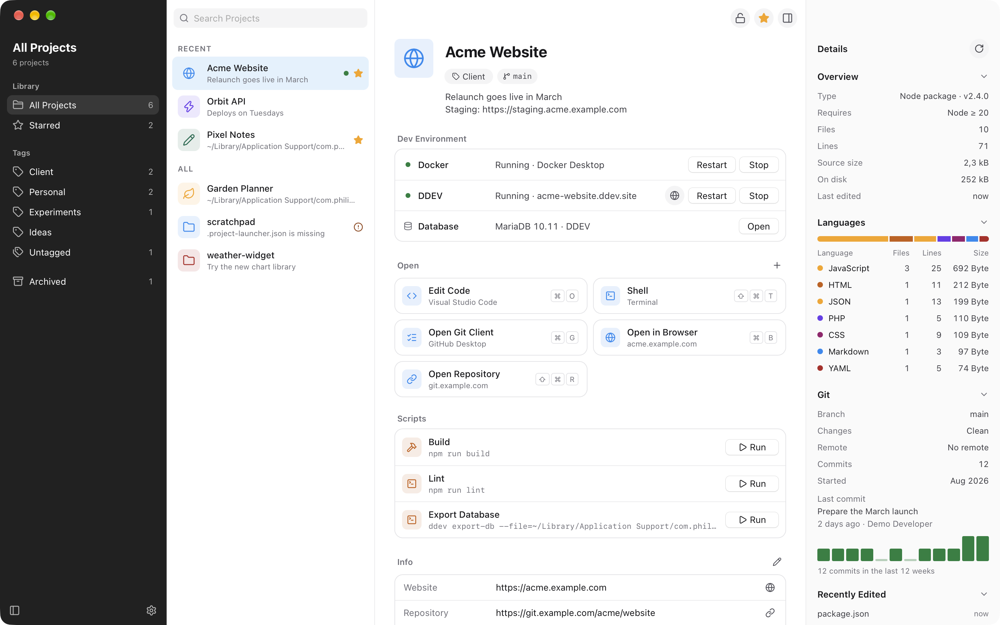
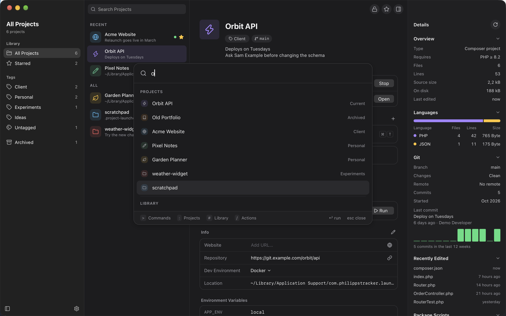
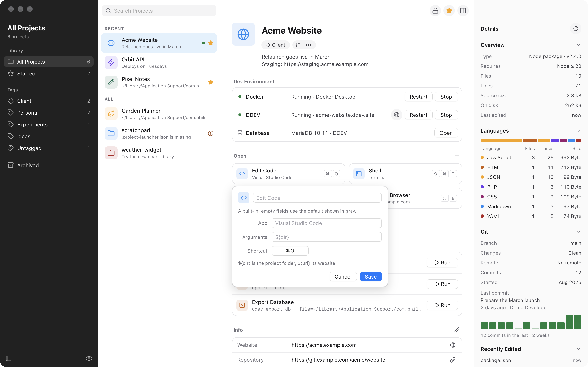
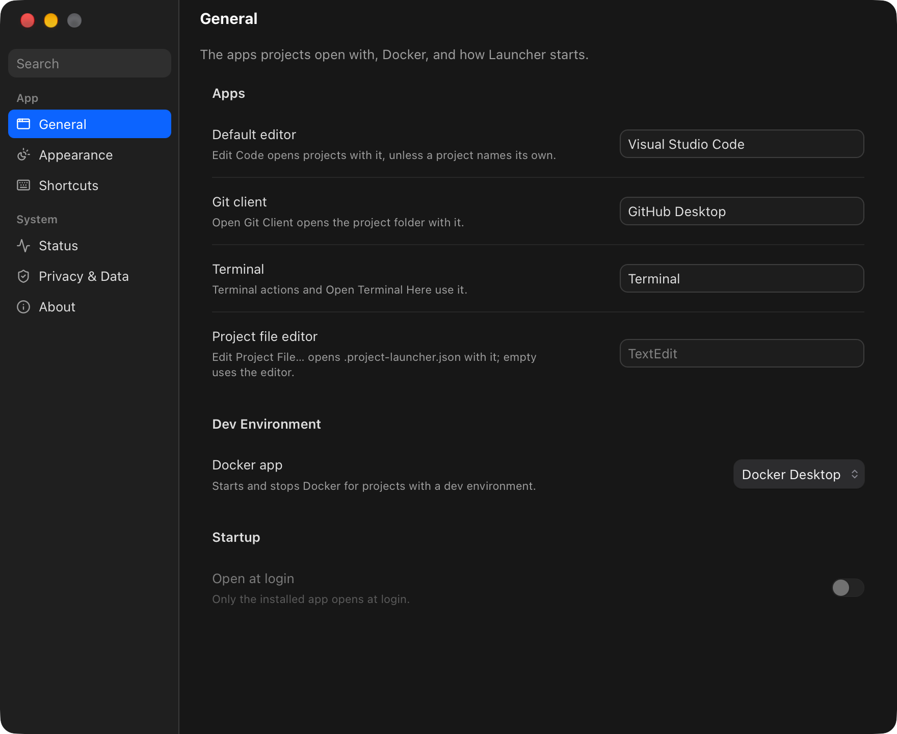

# Launcher

My launcher for coding projects on macOS: a menu-bar app that lists, searches and manages my project folders
and opens what each one needs with one click or key: its editor, terminal, git client, URLs, Claude Code,
scripts, its local dev server (Docker, DDEV, wp-env) and its database in [DataBee](../databee).

Everything about a project lives in a hand-editable `.project-launcher.json` in its root, so the setup travels
with the project and stays readable without the app. Launcher has no network code and no telemetry.

It is a local tool for one person on one Mac. Published as source, as-is: no releases, no binaries, no
support. To build it or port it, point a coding agent at [AGENTS.md](AGENTS.md).

<picture>
  <source media="(prefers-color-scheme: dark)" srcset="docs/screens/main-dark.png">
  
</picture>

## What it does

- **Every project in one list:** add project folders (several at once), give each a name, icon, colour, tag
  and notes, star or archive it. The sidebar filters by Starred, by tag, Untagged and Archived; the list shows
  what you opened in the last three days on top, and a green dot where the dev server runs. Everything is
  edited in place and every change undoes with ⌘Z.
- **One click or key per task:** each project's Open grid holds its editor, terminal, git client, website,
  repository, Claude Code and actions of your own (an app, a URL or a terminal command), each with its own
  icon, colour and key (⌘O opens the editor, ⇧⌘T a shell). Scripts run with their output shown below them, or
  in a terminal tab that comes to the front again while it still runs. States read from a command's output
  can hide actions that don't fit right now.
- **The dev environment:** for a project on Docker, DDEV or wp-env, Launcher starts Docker (Docker Desktop,
  OrbStack, Colima or your own commands) and the server the first time you launch something, shows whether it
  runs with its URL, and starts, stops and restarts it. Its MySQL or MariaDB database opens in DataBee with the
  right connection, found in the DDEV or wp-env setup or given as a URL.
- **The project file:** apps, scripts, environment variables, states and the database live in
  `.project-launcher.json`, which you can edit by hand or in the app; Launcher reads it fresh before each change
  and keeps every key it doesn't change, in its place. A locked project is read-only in the app.
- **The inspector:** what kind of project it is and what it requires, its dependencies, files, lines and size,
  its languages, its git branch, changes, commits and twelve weeks of activity, the files edited last (a click
  opens one in the editor) and the scripts of `package.json` and `composer.json`.
- **From anywhere:** the menu-bar icon lists recent projects and the current one's actions; ⌃⌘L shows the
  window from any app; ⌘K opens the command palette, a floating panel that finds projects, filters, the
  current project's actions and every command (`>` commands, `:` projects, `#` library, `/` actions).
- **Keyboard first:** ↑↓ move through the list wherever you are, every action has a menu item and a
  rebindable key, right-click menus offer the rest, and the `launcher` command line does what the window does.

| | |
|---|---|
|  |  |
|  | |

All screenshots show made-up demo data from the debug build.

## The project file

```json
{
  "name": "Acme Website",
  "meta": { "icon": "Globe", "color": "Blue", "tag": "Client", "url": "https://acme.example.com" },
  "dev": { "ddev": true },
  "env": { "APP_ENV": "local" },
  "apps": [
    "editor",
    { "preset": "terminal", "label": "Shell", "shortcut": "cmd+shift+t" },
    { "label": "API Docs", "url": "${url}/docs", "icon": "Book" }
  ],
  "scripts": [{ "label": "Build", "command": "npm run build", "icon": "Hammer" }]
}
```

Every key is optional. [docs/project-file.md](docs/project-file.md) lists them all: the built-in apps,
placeholders (`${dir}`, `${url}`, `~`), states, the database and locking.

## Privacy

- No network code: Launcher never connects anywhere; links open in your browser.
- Its own data (settings, the tag list, the list of known project files with their last-opened times, the
  window's size and the sidebar choice) stays in `~/Library/Application Support/com.philippstracker.launcher/`. Everything else is in each
  project's own `.project-launcher.json`.
- A database URL's password never reaches the window; DataBee gets it through its environment.
- It runs only what you tell it to: your apps, your scripts, and `git`, `du`, `docker` and `ddev` to read a
  project's state.

## Install

```sh
bun install
scripts/create-signing-cert.sh   # once per Mac, only without an Apple Development certificate
bun run release patch            # builds, signs and installs it
```

This builds `Launcher.app`, installs it into `~/Applications` and links the `launcher` command into
`~/.local/bin`. It runs on macOS on Apple Silicon only. Settings → General → Open at login keeps it in the
menu bar.

## Command line

The `launcher` command drives the running app. A project is its name (or a unique part of it), its id, or a
folder inside it, so `launcher describe .` describes the project you are in.

| Command | Does |
|---|---|
| `launcher` | starts Launcher, or brings the running one to the front; `--hidden` starts it in the menu bar |
| `launcher show`, `focus`, `hide`, `quit`, `status` | the window and the app |
| `launcher list [--json]` | every project with its tag and folder |
| `launcher describe [PROJECT]` | a project's details, apps and scripts (default: the current folder's) |
| `launcher open PROJECT` | shows the project in the window |
| `launcher launch PROJECT APP` | opens one of its apps (`launcher launch acme edit`) |
| `launcher run PROJECT SCRIPT` | runs one of its scripts and prints the output; a failed script exits with 1 |
| `launcher terminal`, `finder`, `config`, `db` `PROJECT` | a shell in its folder, the folder in Finder, its project file, its database in DataBee |
| `launcher palette`, `settings` | the command palette, Settings |
| `launcher commands`, `command ID` | the command ids, and runs one |

`--json` prints any reply as JSON. Exit codes: 0 ok, 1 Launcher refused the request (the reason is printed),
2 bad arguments or "Launcher isn't running".

```sh
launcher run . build
launcher terminal "orbit api"
launcher list --json | jq -r '.[] | select(.tag == "Client") | .name'
```

## Docs

[docs/README.md](docs/README.md) is the index of the technical documentation.

## License

MIT, see [LICENSE](LICENSE).
